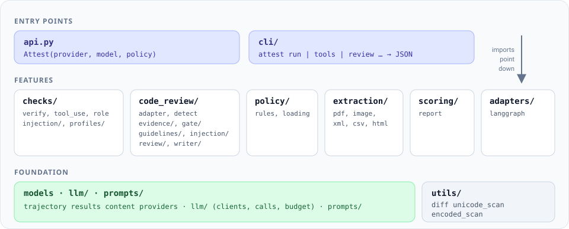

# Architecture

For contributors: how the codebase is organised and where to make a change.

{ .diagram }

attest is split into layers. Imports only point down: entry points use the features, and
features use the shared foundation (the data models, `llm/`, `prompts/`) and
`utils/`. The foundation never imports a feature, so a feature can't quietly become a
dependency of everything else.

## Layers

**Entry points.** `api.py` holds `Attest`, which keeps the provider, model, client and policy
and runs checks with them. `cli/` is the `attest` command, one module per command group in
`cli/commands/`. Both are thin and call into the features. Every command prints its result
through `cli/json_output.py`, which holds the versioned JSON envelope, the per-command output
models and the JSON Schemas built from them. `cli/usage_errors.py` prints usage errors, such
as an unknown option, as the same JSON error envelope.

**Features.** One package per job:

| Package | Job |
|---|---|
| `checks/` | Faithfulness (`verify.py`), tool use, role adherence and prompt injection. `profiles/` picks the grading standard for each answer kind. |
| `code_review/` | Code review mode: the adapter from reviewer outputs to runs, evidence budgeting, the gate, injection checks for diffs, review guidelines (`guidelines/`), the one-call `review()` (`review/`), and attest's own reviewer (`writer/`). |
| `policy/` | Project rules: models, loading from YAML or JSON, deterministic and semantic evaluation. |
| `extraction/` | Bounded text extraction from PDFs, images, XML, CSV, HTML and JSON for the injection scan. |
| `scoring/` | `evaluate()`, which runs the selected checks and assembles a `Report`. |
| `adapters/` | Converters from agent frameworks to runs. LangGraph and Haystack are built in. |

**Foundation.**

| Package | Job |
|---|---|
| Data models | `trajectory.py`, `results.py` and `content.py`: `Trajectory`, `Report`, `CheckResult`, `Finding`, `Artifact`. |
| `disposition_rules.py` | How a finding's check, verdict and severity map to pass, review or block. `VerdictPolicy` passes its choices; a `Report` uses the defaults for findings without a disposition. |
| `providers.py` | The supported providers, their model lists and API keys, and building a client. |
| `llm/` | The structured `call()` and `vote()`, the provider clients, response caching, and spend budgets. |
| `prompts/` | Every prompt attest sends, one module per feature, with `PROMPT_VERSION` in `prompts/version.py`. |
| `utils/` | Small stateless helpers shared across features: unified-diff parsing, hidden-Unicode and encoded-payload scanning, strict JSON and YAML loading. |

## Design rules

- **Tool outputs are the only evidence.** No check reads the agent's `thought` text when
  deciding whether a claim is true.
- **Untrusted text is data.** Anything an attacker could write reaches a judge only inside a
  bounded, escaped, clearly delimited block, framed as content to judge.
- **Prompts live in one place.** All prompt text is in `prompts/`. Each answer kind has its own
  module in `prompts/profiles/`, and tests pin the `factual` and `plan` prompts by SHA-256, so
  work on `code` can't change how plain text is graded.
- **Incomplete is not clean.** Content that couldn't be scanned or extracted, or a budget that
  ran out, is reported as incomplete coverage, never as a pass.
- **Clients are lazy.** Deterministic checks never create an API client, so they run with no key.

## Where things live

| To change | Look in |
|---|---|
| How claims are extracted or verified | `checks/verify.py`, `checks/profiles/`, `prompts/profiles/` |
| Any prompt text | `prompts/` |
| The code review gate | `code_review/gate/` |
| How review guidelines are parsed and checked | `code_review/guidelines/` |
| How large diffs are cut | `code_review/evidence/` |
| Injection patterns and detectors | `checks/injection/` |
| Supported models | `providers.py` |
| Model calls, caching and budgets | `llm/` |
| CLI commands | `cli/commands/` |
| The CLI's JSON output and schemas | `cli/json_output.py` (then run `docs/scripts/write_schemas.py`) |
