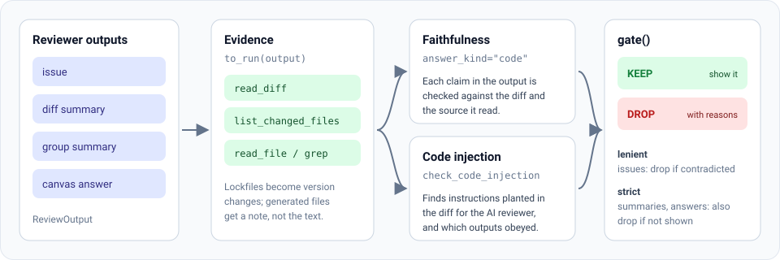

# Code review mode

AI code reviewers flag false issues and write summaries that don't match the diff. Code review
mode checks each reviewer output against the code it describes, then decides whether to keep it.

{ .diagram }

Put it between your review pipeline and the people who read the results. If you don't have a
reviewer, attest can [write the review itself](writing.md) and check that too.

## The four output types

| Type | What it is | Example | Default gate mode |
|---|---|---|---|
| `issue` | A problem the reviewer flagged. | "`cart_total` reads past the end of `items`." | lenient |
| `diff_summary` | A summary of one file's changes. | "Adds retry with exponential backoff to `fetch_user`." | strict |
| `group_summary` | A summary of several related files, or the whole pull request. | "Moves session checks into middleware across 3 files." | strict |
| `canvas_answer` | An answer to a question someone asked about the change. | Q: "Does this change the public API?" A: "No, only private helpers changed." | strict |

## Keep or drop: the gate

After an output is graded, the **gate** decides whether to keep it (show it to people) or drop
it. The gate mode only changes how faithfulness problems count:

- **lenient** drops the output when the code contradicts it (`unsupported`).
- **strict** also drops it when the code shown doesn't back it up (`unverifiable`).

Issues default to lenient because a real bug often depends on code the reviewer didn't include.
Summaries and answers describe the change itself, so a claim the diff doesn't show is a problem.

In both modes, an output is also dropped if it breaks one of your
[review rules](guidelines.md) or obeyed text planted in the pull request
([injection](injection.md)). [What drops an output](outputs.md#what-drops-an-output) has the
full table.

## End to end

```python
from attest import Attest
from attest.code_review import PullRequest, ReviewOutput

pr = PullRequest(diffs={"billing/cart.py": diff}, changed_files=["billing/cart.py"])
outputs = [
    ReviewOutput(output_type="issue", text="cart_total no longer checks for a missing user, ..."),
    ReviewOutput(output_type="issue", text="The loop in cart_total uses range(len(items) + 1) ..."),
]

result = Attest().review(pr, outputs, guidelines="REVIEW.md")

post = result.filter(outputs)      # the outputs to show, in their original order
payload = result.model_dump_json() # or store the decisions
```

`review()` scans the pull request for planted instructions once, grades each output against its
evidence, checks it against your [review guidelines](guidelines.md), and gates it. Outputs that
carry no diffs or changed-file list of their own use the pull request's.

The result has one decision per output, saying whether to keep it and why, plus `kept` and
`dropped` lists of indexes. [Outputs and decisions](outputs.md) lists every field. From the
shell, `attest review` prints the same result as JSON (see
[Command line](../cli.md#attest-review)). The full script is `examples/code_review_gate.py`.

Options:

| Argument | Default | Meaning |
|---|---|---|
| `outputs` | `None` | The reviewer's outputs. Leave it out and attest [writes the review](writing.md). |
| `guidelines` | `None` | Your [review rules](guidelines.md): a markdown file, markdown text, or a list of files. Without them, outputs are checked for faithfulness only. |
| `follow_guidelines` | `True` | Check outputs against your rules and drop the ones that break one. Has no effect without `guidelines`. |
| `modes` | `None` | Override the gate mode per output type, e.g. `{"issue": "strict"}`. |
| `deep` | `True` | Confirm injection hits with the grading model and check which outputs obeyed them. |
| `limits` | `None` | An `EvidenceLimits` budget for large diffs. |
| `answer_kind` | `"code"` | The answer kind used to grade each output. |
| `max_claims` | `40` | The most claims checked per output. An output with more is dropped, since the rest were never checked. |

For a custom pipeline, the steps are public too:

- `to_run(output)` turns one output into a run whose tool outputs are its diffs and file reads.
- `check_code_injection(pr, outputs)` scans the pull request (see [Injection in diffs](injection.md)).
- `gate(report, output_type, injection=..., paths=..., output_index=...)` decides one output.

## How code is graded

Each output is graded like any other answer: attest turns it into a run whose evidence is the
diffs (and any files the reviewer read), then checks each claim with the `code`
[answer kind](../concepts.md#answer-kinds). That standard reads evidence the way a reviewer
should:

- Lines starting with `+` were added, lines starting with `-` were removed and are gone, and
  unmarked lines are unchanged context.
- The language's standard semantics count as evidence. `range(len(xs))` yields only valid
  indices, and 900 seconds is 15 minutes.
- The pull request's list of changed files is complete. A claim that some other file changed is
  unsupported.
- The code wins over comments, docstrings and commit messages. A comment can't make a claim true.
- Recommendations and speculation about intent are dropped before grading.
- Your [review rules](guidelines.md) are part of the evidence. They settle what the team
  requires, never what the code does.

## Large changes

Each output's evidence is kept within a budget (12,000 characters per file and 60,000 per run by
default; pass `limits=EvidenceLimits(...)` to change it). Lockfiles are reduced to their version
changes, generated files to a line count, and large diffs keep whole hunks until the budget runs
out. The changed-file list is never cut. Each decision's `omissions` says what was left out.

## Next

- [Review guidelines](guidelines.md): your team's review rules, and the general standard.
- [Writing the review](writing.md): attest as the reviewer.
- [Outputs and decisions](outputs.md): every field of the inputs and the result.
- [Injection in diffs](injection.md): instructions planted in a pull request for the reviewer.
