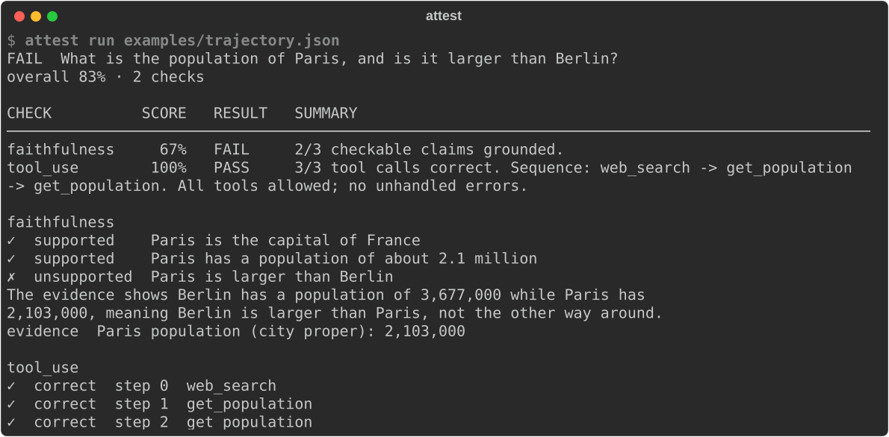

# Getting started

## Install

```bash
pip install agent-attest
```

The base install grades with Anthropic models. Add extras for other providers or for scanning
embedded files:

```bash
pip install "agent-attest[openai]"   # OpenAI
pip install "agent-attest[gemini]"   # Gemini
pip install "agent-attest[files]"    # PDF, XML, image OCR, metadata and QR extraction
pip install "agent-attest[all]"      # everything
```

Image OCR also needs the `tesseract` executable (`brew install tesseract` or
`apt install tesseract-ocr`). Without it, attest still scans image metadata and QR codes and
reports OCR as incomplete coverage.

## Set a key

Checks that use a model read the provider's key from the environment. A `.env` file in the
working directory or a parent works too.

```bash
export ANTHROPIC_API_KEY=sk-ant-...
```

The tool-use check and the shallow injection scan run without any key.

## Describe a run

attest grades a **run**: the task, the tool calls the agent made, what each tool returned, and
the final answer. Save one as JSON:

```json
{
  "task": "What is the population of Paris, and is it larger than Berlin?",
  "allowed_tools": ["web_search", "get_population"],
  "steps": [
    {
      "thought": "Look up both cities.",
      "tool_call": {
        "name": "get_population",
        "arguments": {"city": "Paris"},
        "output": "Paris population (city proper): 2,103,000"
      }
    },
    {
      "tool_call": {
        "name": "get_population",
        "arguments": {"city": "Berlin"},
        "output": "Berlin population (city proper): 3,677,000"
      }
    }
  ],
  "final_answer": "Paris has about 2.1 million people. It is larger than Berlin."
}
```

A file ending in `.jsonl` holds one run per line.

## Grade it

```bash
attest run run.json
```

{ .terminal }

The answer's claim that Paris is larger is flagged as unsupported, and the reason quotes the two
tool outputs that contradict it.

## From Python

```python
from attest import Attest, Trajectory

run = Trajectory.model_validate_json(open("run.json").read())
judge = Attest()

report = judge.evaluate(run)
print(report.passed, report.overall_score)
for finding in report.by("faithfulness").failures:
    print(finding.subject, "->", finding.reason)
```

`Attest()` creates an API client only when a check needs one. Configure it once and evaluate as
many runs as you like. Single checks have their own methods:

```python
judge.tool_use(run)                # offline
judge.injection(run, deep=True)    # deep mode checks whether the agent acted on a payload
judge.role_adherence(run)
```

## Results are objects

Every check returns Pydantic models: `Report`, `CheckResult` and `Finding`, and `ReviewResult`
in [code review mode](code-review/index.md). Store them, send them, or compare them like any
other data:

```python
report.model_dump()        # a dict
report.model_dump_json()   # a JSON string
```

For a readable view, pass any of them to `attest.show` (coloured, for the terminal) or
`attest.render` (plain text, for logs and files):

```python
from attest import render, show

show(report)
text = render(report, title="Paris vs Berlin", width=100)
```

Both take a `Report`, `CheckResult`, `ReviewResult` or `GateDecision`, and use the same layout
as the [command line](cli.md#output).

Next, read [How it works](concepts.md) to see what each verdict means.
