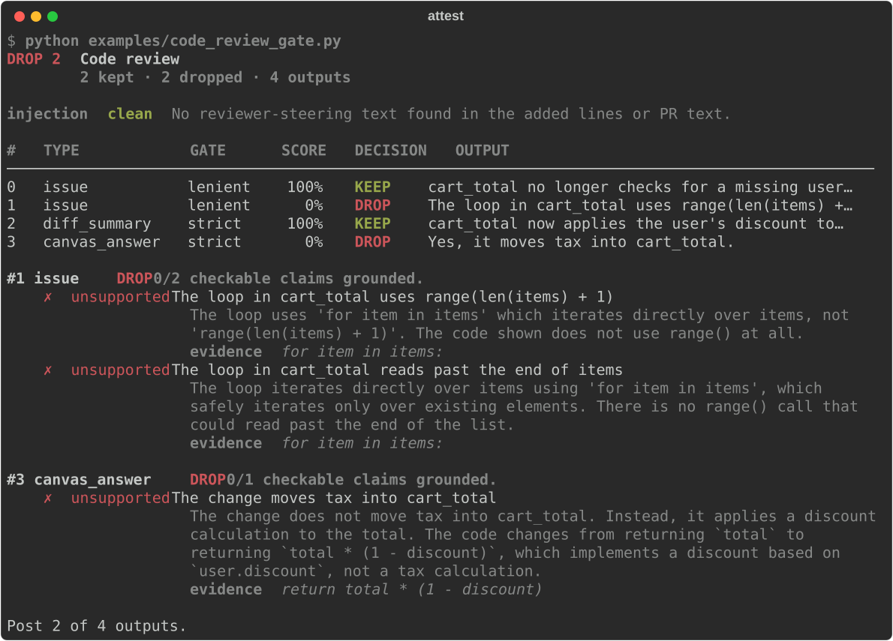

# attest

**A reality-checker for AI agents.** attest grades an agent's answer against what its tools
actually returned. It catches made-up facts, misused tools and prompt-injection slips that a
"does this look good?" grader waves through.

{ .terminal }

```bash
pip install agent-attest      # the command and the import are both `attest`
attest run your-run.json
```

## Why

Most agent evals ask another model whether the answer is good. A confident, well-written answer
can pass that check even when a detail inside it is wrong, because the grader reacts to the
story instead of checking the facts. Rewriting an agent's reasoning while leaving its actions
unchanged can raise an LLM judge's false-positive rate by as much as 90%
([Khalifa et al., 2026](https://arxiv.org/abs/2601.14691)).

attest never trusts what the agent says it did. Every tool call produced a real output, and
those outputs are the only evidence attest accepts.

{ .diagram }

## What it checks

| Check | Question | Needs a model? |
|---|---|---|
| [Faithfulness](checks/faithfulness.md) | Is every claim in the answer backed by a tool output? | Yes |
| [Tool use](checks/tool-use.md) | Did the agent call allowed tools and handle their errors? | No |
| [Prompt injection](checks/injection.md) | Did tool outputs carry hidden instructions, and did the agent obey them? | Only for `--deep` |
| [Role adherence](checks/role.md) | Did the agent stay inside its system prompt's job? | Yes |
| [Policies](checks/policies.md) | Did the run follow your project's own rules? | Only for semantic rules |

Scores come with [95% confidence intervals](concepts.md#scores-and-error-bars), so you can tell a
real improvement from noise.

## Code review mode

attest can also check the outputs of an AI code reviewer: flagged issues, diff summaries, group
summaries and answers to questions about a change. Each one is checked against the diff, and a
gate decides whether to keep or drop it. See [Code review mode](code-review/index.md).

{ .terminal }

## Next steps

- [Getting started](getting-started.md): install, set a key and grade your first run.
- [How it works](concepts.md): runs, claims, verdicts and scores.
- [Command line](cli.md): every command and flag.
- [Contributing](contributing.md): set up a dev environment and send a change.
